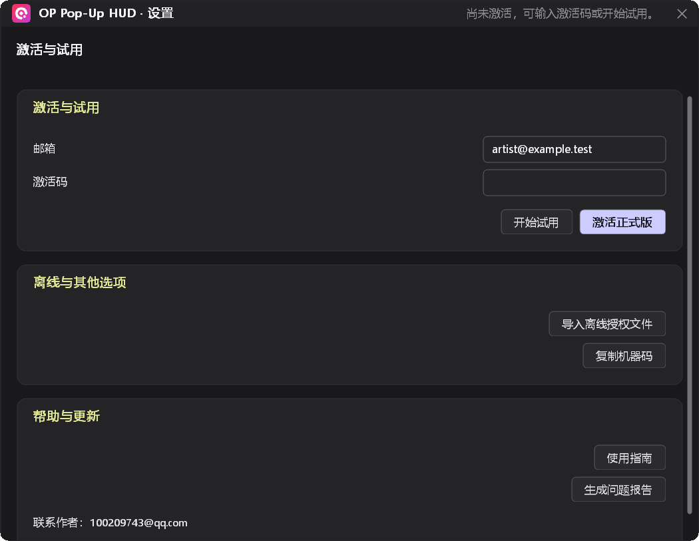
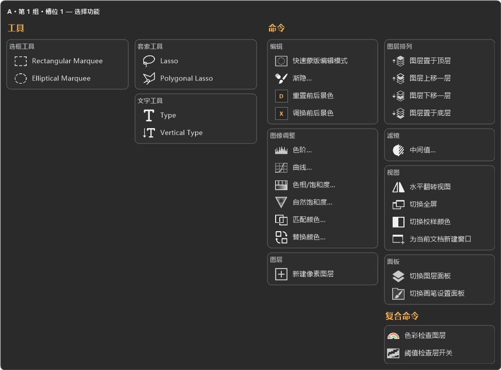
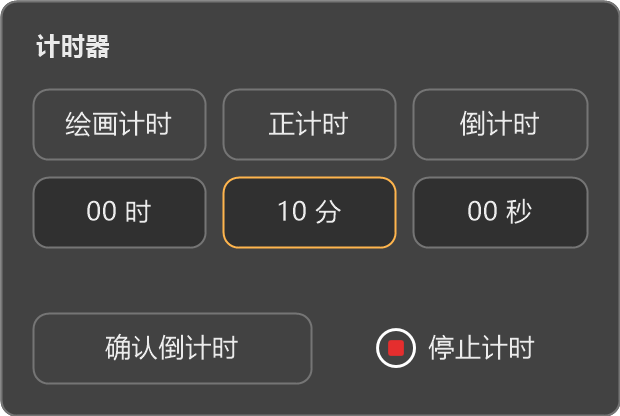
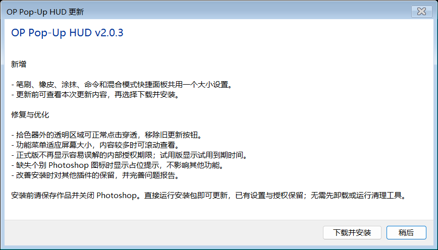

# OP Pop-Up HUD 使用指南

适用于 Windows 64 位与 Photoshop 2024（25.1）及以上版本。本指南对应 2.0.7。

界面图解使用示例账户、路径和版本。短视频为无声步骤图解，可暂停或全屏查看。

## 安装

1. 保存作品，退出 Photoshop 和 HUD，双击安装程序，按提示安装。
2. 打开 Photoshop，选择 **增效工具 → OP Pop-Up HUD → OP Pop-Up HUD · 设置**。首次出现启动 HUD 的权限提示时，选择允许。
3. 在授权页面输入邮箱，激活正式版或开始试用，然后打开一份绘画文档。正常更新保留设置与授权。

如果安装器提示 Photoshop 或 HUD 仍在运行，请保留安装窗口，保存作品并关闭列出的程序，再点击 **已关闭，继续安装**。点击 **返回** 可回到准备安装页；安装器不会强制关闭程序。

使用当前 Windows 账户安装，不要换用另一个账户。普通安装无需先运行清理工具。
安装无需打开或登录 Creative Cloud。正常更新和同版本重装，直接运行安装包即可。
仅当安装器提示需要迁移旧安装时，先运行配套的独立清理工具，再安装。
清理保留授权、设置、笔刷和录像；旧程序目录里的额外文件会归档保留。
独立清理工具用于手动维护；重置设置、清理独立 OK-Record 都需要明确选择。

未激活时，从 **增效工具** 菜单打开的窗口居中显示，只提供授权页面。激活或领取试用后，设置分类、Toolbar 和绘画快捷键解锁；点击 Toolbar 的 **设置**，同一个窗口会在按钮上方展开。Toolbar 隐藏或没有打开文档时，仍可从增效工具菜单进入。

## 激活或试用

| 使用方式 | 操作 |
| --- | --- |
| 已有激活码 | 先填邮箱，再填激活码，点击 **激活正式版**。旧用户使用原邮箱和原激活码。 |
| 先试用 | 只填邮箱，点击 **开始试用**，全部功能开放。 |
| 试用后购买或更换激活码 | 切到 **管理授权**，填写邮箱和新激活码，点击 **激活正式版**，无需重装或先清除原授权。 |

正式版显示激活状态；试用版显示试用结束的本地日期和时间。

首次激活和领取试用需要联网。试用从首次领取成功起连续计算 7 天，重装、清除本机激活或重复领取都不会重新计时。

[安装与激活：18 秒无声图解](../assets/tutorials/installation.mp4)

## 开始绘画

让 Photoshop 处于前台，将指针移回画布。以下是默认快捷键，也可以在 **设置 → 通用快捷键** 中修改。

| 操作 | 用途 |
| --- | --- |
| 按住 **Q** | 打开光标附近的拾色器。 |
| 按住 **W** | 打开画笔预设面板；W 本身不切换当前工具。 |
| 短按 **E / R** | 选择橡皮 / 涂抹；继续按住可打开各自的预设面板。 |
| 按住 **Z** | 打开命令面板。 |
| 按住 **F** | 立即显示混合模式收藏，松开确认选择；在中心松开不改变当前模式。 |
| 按住 **S** 并水平移动 | 调整笔刷大小。 |
| 按住 **S + 鼠标右键** 并水平移动 | 调整不透明度。 |
| 按住 **S + 鼠标左键** 并垂直移动 | 调整笔刷角度。 |

在 W、E、R、Z、F 面板中，指向需要的槽位后松开快捷键即可选择；也可以左键点击应用。指针回到面板中心再松键，可取消选择。

按住 **Q** 时，**W / E** 可增加／降低明度。若需调节色相，在 **设置 → 通用快捷键** 中自行绑定“降低色相”和“增加色相”（默认未分配），再按住 Q 使用；长按可连续调整。**设置 → 颜色拾色器** 中可分别设置明度与色相步长，色相默认每次 **1°**，范围 **1°–360°**，到达色环边界会循环衔接。

在 **设置 → 通用快捷键 → 通用 → 快捷面板大小 (%)** 中统一调整这些面板的大小，范围为 **50%–200%**。点击 **跟随全局 HUD**，即可恢复随 HUD 大小一起变化。

同一区域的 **快捷面板高亮颜色** 可设置 W／E／R／Z／F 槽位的悬停底色和选中描边。输入 `#RRGGBB` 色值并确认后生效，默认黄色 `#FFB219`；普通槽位仍为灰色。

中央图标大小可在 **设置 → 笔刷手势 → W 收藏组** 或 **命令面板 → 分组** 中调整。修改 **图标大小**（默认 50，范围 1–80），按 Enter 或点击其他输入框保存；图标会保持居中和比例，并随面板整体缩放。各组独立保存，E／R 共用 W 第 1 组。旁边的 **恢复默认** 只将大小改回 50。

替换中央图标：选好分组，点击 **打开图标文件夹**，放入对应的 `group-1.svg` 或 `group-1.png`（数字为分组序号），再点击 **重新加载图标**。同组只保留一个文件；PNG 保留原色和透明度，SVG 使用 **Logo 颜色**。透明留白会自动排除。**恢复默认 Logo** 会删除该组的自定义图标并恢复产品 Logo。

如需用 A／D 增减笔刷大小，可在 Photoshop 的键盘快捷键中，将原生 `[`／`]` 对应功能改绑到 A／D。

将当前笔刷存入收藏：先在 Photoshop 选好笔刷，按住 W 打开面板，在目标槽位 **Shift + 中键点击**。清空槽位使用 **Shift + Alt + 中键点击**。

Toolbar 的前景色或背景色图标支持 **Alt + 左键重置前后景色**、**Shift + 左键调换前后景色**，效果分别与 Photoshop 的 D、X 相同。双击前景色仍可打开 Photoshop 拾色器。

[开始绘画：18 秒无声图解](../assets/tutorials/painting.mp4)

## 整理 Toolbar 和命令面板

- **调整顺序**：在 Toolbar 的工具上按住中键，拖到新位置后松开。
- **收起工具**：将工具中键拖出 Toolbar。需要恢复时，点击 **…** 打开收纳菜单，再把工具中键拖回；工具全部收起后，可拖到 **…** 区域恢复第一项。也可在收纳菜单中的目标工具上短按中键直接追加。
- **设置命令面板槽位**：按住 Z，在目标槽位 **Shift + 中键点击**，选择需要的工具或命令；也可在 **命令面板** 设置中修改。
- **添加颜色命令**：在槽位的命令列表中选择 **编辑 → 重置前后景色／调换前后景色**。
- **新增 Toolbar 槽位**：在 **工具栏 → 工具栏槽位** 的 **添加工具或命令** 列表中选定项目，再点击 **添加工具栏槽位**。保存成功后该工具或命令立即加入；已在工具栏中的项目不会重复列出。
- **选择画笔参数圆**：在 **工具栏 → 笔刷参数** 分别开关不透明度、流量、硬度和角度。关闭的圆不占位置；总开关或画笔图标中键显隐会保留这些选择。
- **切换分组**：按住 Z 时按 **1–3**；按住 W 时按对应的 **1–5**，切换已启用的分组。

收纳菜单以 Photoshop 实际启用的工具为准。放在 Photoshop“附加工具”中的项目不会自动出现在这里。

功能选择菜单会适应当前屏幕；内容较多时，将鼠标放在菜单上滚动滚轮，即可查看其余工具和命令。

[整理面板与工具栏：18 秒无声图解](../assets/tutorials/customization.mp4)

需要恢复默认配置时，打开 **设置 → 通用快捷键**，点击底部的 **恢复初始设置**。
确认后，整个产品的界面偏好、快捷键、笔刷收藏和工具/命令槽位会恢复初始状态；
授权、作品、录制项目和自定义图标文件保留。此操作会覆盖自定义配置，请先核对确认提示。

## 录制与步骤图

1. 先保存绘画文档，点击 Toolbar 的 **设置**，选择 **录制与导出**，确认录制保存位置、采样间隔及 **分辨率**。保存路径右侧的文件夹图标可选择保存目录。
2. 点击 **Toolbar 的录制按钮**，正常绘画。再次点击可以暂停或继续。
3. 需要保存关键进度时，点击 **Toolbar 的保存步骤图按钮**。
4. 点击 **录制保存位置** 右侧的序列帧图标、步骤图图标查看对应文件夹。
5. 结束录制时，按住 **Shift + Alt**，左键点击录制按钮。已有序列帧保留，再次开始会继续当前文档的时间线。
6. 暂停或停止录制后，在下方 **导出设置** 确认素材来源，设置视频时长、每帧停留，再点击 **导出视频**。完成后点击 **导出位置** 右侧的文件夹图标查看视频；导出中可取消。

录制保存画布变化，不录制屏幕、鼠标和弹窗。切换到其他文档会暂停当前文档采样，切回后继续。关闭设置不会停止后台录制、计时或导出。

红点表示正在录制，黄色暂停标记表示已暂停。

长路径会优先显示末尾；悬停可查看完整地址，点击路径后可选中复制。导出按钮不可用时，下方会说明原因。

**分辨率** 同时影响新录制帧和导出视频。修改前需停止录制；提高分辨率不会恢复已有帧中缺失的细节。

视频导出组件已随 HUD 安装，无需另外安装 FFmpeg。

录制输出使用 8 位像素；16 位源画面会转换为 8 位录制图像，原文档保持不变。暂不支持录制 32 位 HDR 文档。

在 **导出设置** 中导出已有录制或图片序列时，点击 **选择序列帧** 路径右侧的文件夹图标。要导出当前文档的录制，点击 **使用当前录制**，确认来源后再导出。原录制不会被自动移动或删除。需要手动删除时，先停止录制和导出；帧图片与配套数据应一起处理，重要录制请先备份。

[录制与导出：18 秒无声图解](../assets/tutorials/recording.mp4)

下面是专用几何风景文档导出的 10 秒结果示例。

[播放录制结果示例](../assets/tutorials/recording-result.mp4)

## 计时器

单击计时器可开始、暂停或继续。**按住鼠标左键约半秒**打开控制面板，可选择绘画计时、秒表或倒计时，设置倒计时时长，并停止计时。

绘画计时达到设置的空闲时长后会自动暂停；从自动暂停状态继续绘画时恢复累计。切换计时模式会重置上一模式，等待再次单击开始。

鼠标悬停在计时器上，可查看当前模式和状态；绘画计时等待下笔时显示“等待绘画”。

[使用计时器：18 秒无声图解](../assets/tutorials/timers.mp4)

## 更新

1. 有新版本时，Toolbar 右侧显示蓝色 **NEW**。点击后选择 **安装更新…** 或 **稍后提醒**。
2. 选择 **稍后提醒** 后，NEW 消失，重启也不会再次提示这个版本。以后可打开 **设置 → 账户帮助**，点击 **安装更新…**。
3. 选择 **安装更新…**，查看新版本的新增与修复内容，再点击 **下载并安装**。也可选择 **稍后**。下载和校验完成后，保留安装窗口，保存作品并退出安装器列出的 Photoshop 和 HUD，再点击 **已关闭，继续安装**。

没有可用更新时，NEW 和设置中的版本更新区域都不显示。正常更新保留当前设置与授权。

此前安装失败的用户可直接运行新版安装包重试；仅当安装器提示需要清理旧安装时，先运行配套的独立清理工具，再安装。

下图使用历史版本内容展示更新窗口，不代表当前有可用更新。

[查看更新：18 秒无声图解](../assets/tutorials/updates.mp4)

## 卸载与重装

先退出 Photoshop 和 HUD，再到 Windows 的已安装应用列表中找到 **OP Pop-Up**，选择卸载。正常卸载保留设置、授权数据和录制文件，方便以后重装。

同版本修复或安装后续版本，直接运行安装程序即可。需要手动清理时，请使用与新版安装包配套的独立清理工具，不要使用历史版本的清理工具。

## 遇到问题

打开 **设置 → 账户帮助**，点击 **生成问题报告**。完成后点击
**打开报告位置**，将选中的 ZIP 发到 **100209743@qq.com**，简单说明问题；
如有报错截图，请一并发送。

安装报错时，可选中错误说明与网址并复制（Ctrl+A 全选，Ctrl+C 复制）。按提示处理实际未完成的步骤；无需反复登录或重装 Creative Cloud。

安装出错时，错误页面会显示 **生成问题报告**；正常安装页面不显示该按钮。安装器已退出时，可重新运行当前安装包；如再次报错，在错误页面生成报告。无需启动 Photoshop，不收集作品，不会自动发送。

报告包含可获取的安装、迁移与 Adobe 日志，以及采集报告时的权限信息，并对敏感字段脱敏。

| 情况 | 处理方式 |
| --- | --- |
| 安装提示 Photoshop 或 HUD 仍在运行 | 保存作品并关闭所有 Photoshop 和 HUD 窗口，再继续安装。 |
| 安装提示文件或数据无法处理 | 按提示解除文件占用或完成必要权限确认；仍无法继续时，生成问题报告发给作者。 |
| 找不到设置入口 | 确认 Photoshop 为 25.1 及以上，重启 Photoshop，再检查“增效工具”菜单。 |
| 快捷键没有反应 | 检查授权状态，让 Photoshop 处于前台，退出文字输入或弹窗，再将指针移回画布。 |
| 更新提示程序仍在运行 | 保存作品，退出所有 Photoshop 和 HUD 窗口，按安装器提示继续；若已退出安装器，重新运行下载好的安装包。 |
| 清理工具显示“未完成” | 按提示处理；仍无法完成时，将提示截图发给作者核实后再安装。 |
| 提示达到设备上限 | 联系卖家处理设备名额。清除本机激活不会释放服务器设备名额。 |
| 需要离线激活 | 在账户页切到 **离线与其他选项**（已激活时为 **管理授权**），将机器码提供给卖家，收到授权文件后点击 **导入离线授权文件**。 |

## 补充说明

- 授权会在联网时自动刷新。长期离线超过授权凭证有效期后，请联网打开设置；购买权益不会因为清理旧版而丢失。
- 安装包暂未做 Windows 代码签名，首次运行可能出现系统提示。请核对下载来源和文件信息后再继续。
- 报错时请提供提示截图、Photoshop 版本以及出问题前的操作；不要在公开截图中展示激活码。
